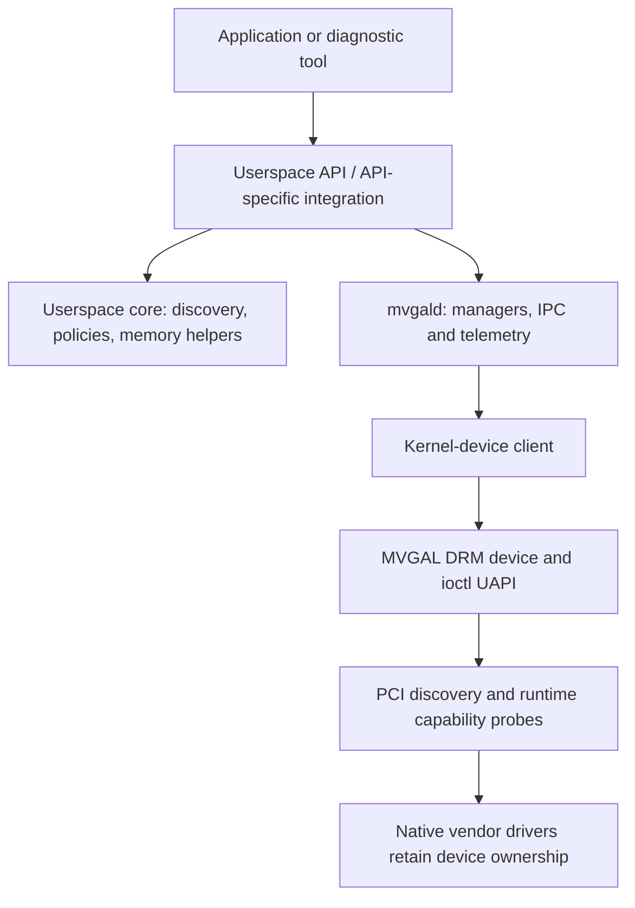

# MVGAL Architecture

This page describes the 0.7.28 source tree. MVGAL is an experimental coordinator and integration layer, not a replacement GPU driver or a transparent way to combine arbitrary GPUs.

## Main components

| Component | Source | Role |
|---|---|---|
| Public interfaces and UAPI | `include/mvgal/` | Public C headers, ioctl structures, capability bits, scheduler and memory API contracts |
| Kernel modules | `kernel/` | DRM device/UAPI, PCI discovery, runtime capability reporting, sysfs, sync and vendor adapters; the native vendor driver retains GPU ownership |
| Userspace core | `src/userspace/` | GPU discovery, C API, scheduler policies, memory helpers, transports, API interception and test topology backend |
| Runtime daemon | `runtime/daemon/` | `mvgald`: device registry, kernel-device client, IPC and D-Bus, scheduler, memory/power managers, metrics, NVML and Steam profile loading |
| Rust components | `safe/`, `runtime/safe/` | Fence, memory-safety and capability helpers; workspace crates and the daemon-facing wrapper are separate source areas |
| Applications and tools | `tools/`, `src/monitoring/`, `ui/` | CLI and diagnostic tools, optional monitoring/exporter and optional Qt dashboard |
| API and platform integrations | `src/userspace/intercept/`, `src/userspace/vulkan_icd/`, `compat/`, `steam/`, `opengl/` | Vulkan layer/opt-in ICD, OpenCL and other wrappers, Linux/Windows compatibility helpers and Steam integration |
| Language bindings | `bindings/` | Clients/wrappers for Rust, Zig, Go, Python, Java, C#, Node.js, Swift and other languages |
| Packaging/deployment | `packaging/`, `config/`, `data/`, `systemd/` | RPM/DEB and other package recipes, helpers, policies and service units |

See [Codebase Map](CODEBASE.md) for a directory-level guide and build entry points.

## Runtime relationships

This is a map of control and reporting paths, not a claim that every API submits work through the daemon. API integrations and build targets are conditional, and each operation depends on the capabilities observed on the host.

## Device ownership and capability truth

The kernel module discovers devices through PCI and does not bind itself as their PCI driver. Vendor drivers remain responsible for GPU command submission and their memory managers. The kernel reports capabilities obtained from probes; an unprobed or unsupported operation must fail or use its documented fallback. Several ioctl numbers and feature flags are reserved for future functionality and do not mean that the corresponding operation is implemented.

The Vulkan ICD is an optional, separate build component. Its presence does not mean a synthetic aggregate physical device exists. The Vulkan layer and ICD must be treated as distinct components. DMA-BUF import/export and peer transfers are device-pair dependent; host staging is the portable fallback where the userspace path supports it.

## CLI output and status contract

The diagnostic tools are meant to be read by people and by scripts, so two
things are fixed:

- **stdout carries only the requested output** — a GPU list, `--json`, a
  table. Informational logging goes to stderr, on every code path
  including the library's pre-initialisation fallback, which is the one
  the tools that print `Configuration loaded from ...` actually take.
- **SIGPIPE is ignored** by every tool, so `mvgal ... | head` exits 0
  instead of dying on signal 13 (shell status 141).

The tools also agree on what a degraded state means, so a script can rely
on the status:

| Tool | 0 | 1 | 2 |
|------|---|---|---|
| `mvgal-compat` | fully operational | not operational | partially operational |
| `mvgal-hw-validate` | all checks passed | a check failed | — |
| `mvgal-workload` | workload passed | failed | — |
| `mvgal-dashboard --check` | display and daemon both up | no display | daemon not running |

`mvgal-compat` used to exit 0 while printing "Not operational", and
`mvgal-dashboard --check` printed "daemon not running" and then "OK" — the
two statements contradicted each other in one output.

`mvgal-config show-config` prints the **effective** configuration: the
parsed values with the built-in defaults applied, which is what the daemon
actually runs on. `mvgal-config show-config --raw` prints the literal
`/etc/mvgal/mvgal.conf` instead.

`mvgal-bench` does not measure GPU performance. It reports memory
bandwidth of `mmap`'d **host RAM** and a single-threaded **host CPU**
DAXPY; every figure is labelled with that hardware path, and `--metadata`
carries `hardware_path`, `mvgal_device_present` and `measures_gpu` so a
consumer can tell host figures from GPU figures without inferring it from
the tool name.

## Build topology

The primary build is CMake. Top-level options gate kernel, runtime, API, gaming, tools, Rust, tests and UI components. Meson is a separate build definition with its own smaller option set; Cargo builds the Rust workspace. A target may be omitted when its optional dependency is unavailable. See [Build Guide](BUILD.md) and the source `CMakeLists.txt` for the exact target graph.

## Related references

- [Codebase Map](CODEBASE.md) — source layout and subsystem ownership.
- [Status](STATUS.md) — version and verified limits.
- [API](API.md) — public interfaces; an API declaration does not establish backend support.
- [Hardware Compatibility](HARDWARE_COMPATIBILITY.md) — device discovery and capability reporting.
- [Scheduling Strategies](STRATEGIES.md) and [Memory Management](MEMORY.md) — policy and transfer boundaries.
